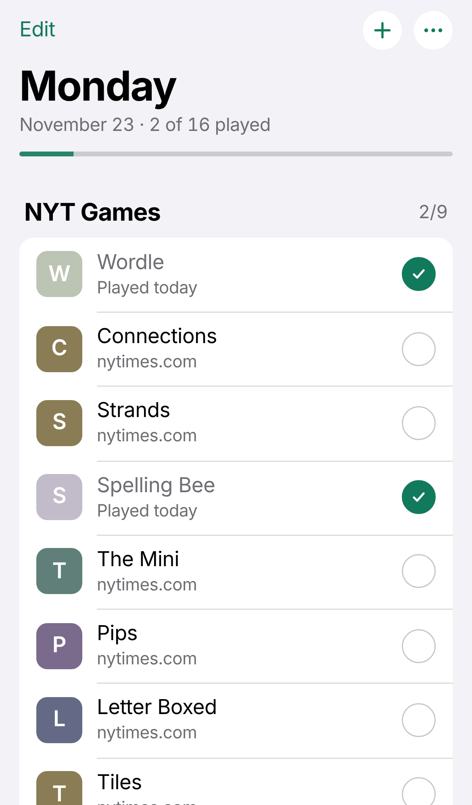
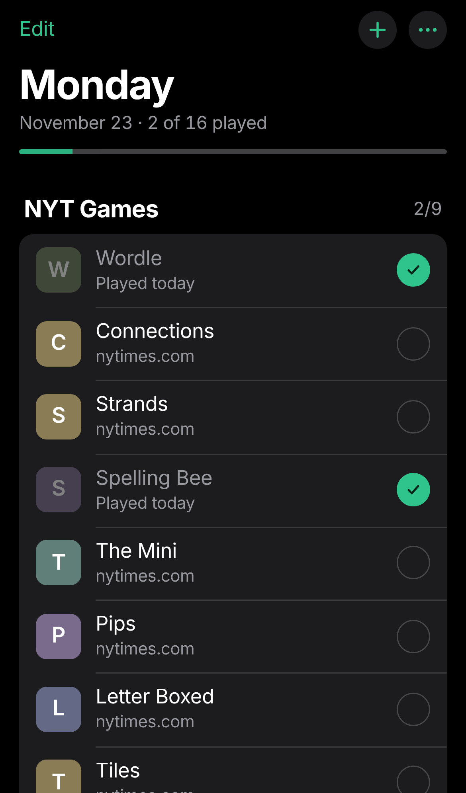

# Petal 🌸

All your daily games in one place: Wordle and the other NYT games, the LinkedIn games, Krillion and any others you add.
It's a web app you can install on your home screen, so it works on any phone (iPhone or Android).

<p>
  
  
</p>

## What it does

- **Tap a game to open it.** It's also marked as played for today.
- **Tick or untick** the circle to mark a game by hand.
- **Daily reset.** Ticks clear at midnight in your time zone. The top of the screen shows today's progress.
- **Streaks.** Each game shows how many days in a row you've played it.
- **Real game icons.** Each game shows its website's own icon, fetched automatically, and you can swap in an emoji or an image link.
- **+ Add any game** with a name, link and group.
- **Groups.** Create, rename, reorder and delete groups, from **Edit** or from **⋯ → New Group**.
- **Edit mode.** Tap a game to change it, use the arrows to reorder, or add a game straight into a group.
- **⋯ Settings:**
  - move played games down, or hide them
  - add from a list of popular games
  - export or import a backup file
  - reset to the default list
- Works offline and follows your phone's light or dark mode.

Your list is saved on your phone (in the browser's local storage). There's no account and no server.
To move your list to a new phone, use **Export backup** and then **Import backup**.

### About the icons

Icons come from Google's favicon service, with DuckDuckGo's as a backup, so those services see the websites in your list.
If neither has an icon, the game gets a lettered tile.
A website has one icon, so games from the same site share it: all the NYT games show the NYT "T" and all the LinkedIn games show the LinkedIn logo.
To tell them apart, give a game its own emoji or image link in its **Icon** field.

## Put it online (free, with GitHub Pages)

1. Merge this branch into `main`.
2. On GitHub, go to the repo's **Settings → Pages**.
3. Under **Build and deployment**, pick **Deploy from a branch**, then choose `main` and `/ (root)`, and click **Save**.
4. After a minute your app is live at `https://<your-username>.github.io/petal/`.

GitHub Pages on a private repo needs a paid plan. If the repo is private, either make it public or use
[Netlify Drop](https://app.netlify.com/drop) or Cloudflare Pages instead. With those you upload the folder and get a link.

## Install it on your phone

- **iPhone (Safari):** open the link, tap **Share**, then **Add to Home Screen**.
- **Android (Chrome):** open the link, tap **⋮**, then **Install app** (or **Add to Home screen**).

It then opens full-screen from its own icon, like a normal app.

## Changing the built-in games

The default and suggested games are in [`games.js`](games.js).
After you change any file, bump `CACHE` in [`sw.js`](sw.js) (e.g. `petal-v2`) so installed copies pick up the update.

## Running it locally

There's no build step. Any static server works:

```sh
python3 -m http.server 8000
# then open http://localhost:8000
```
